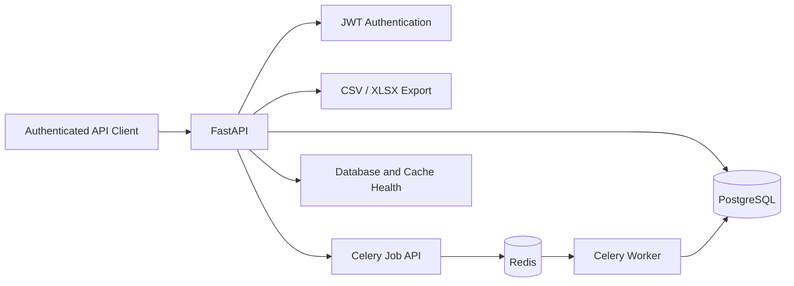

# LedgerForge Task 19 — Exports and Documentation

## Export verification

CSV exports exist for employees, payroll, and ledger entries. Each supports
the date/changed-since parameters described in OpenAPI:

- `GET /api/v1/exports/employees`
- `GET /api/v1/exports/payroll`
- `GET /api/v1/exports/ledger`

All three support `format=csv` or `format=xlsx`. Employees support
`changed_since`; payroll and ledger support `start_date`, `end_date`, and
`changed_since`.

Incremental employee export now includes creation or update timestamps.
Payroll incremental export uses payroll-run `created_at`. Ledger incremental
export uses journal-entry `created_at`.

## Mermaid architecture

## Working API requests

Authentication: `Authorization: Bearer <access_token>` unless the endpoint is
health or public documentation. Obtain a token with `POST /api/v1/auth/login`.
The examples below use the API v1 prefix.

1. `curl -i http://localhost:8000/api/v1/health`
2. `curl -i -X POST http://localhost:8000/api/v1/auth/login -H "Content-Type: application/json" -d '{"username":"<username>","password":"<password>"}'` — login, no bearer required.
3. `curl -i http://localhost:8000/api/v1/employees -H "Authorization: Bearer <token>"` — ADMIN/HR.
4. `curl -i "http://localhost:8000/api/v1/employees?skip=0&limit=100" -H "Authorization: Bearer <token>"` — ADMIN/HR.
5. `curl -i "http://localhost:8000/api/v1/exports/employees?changed_since=2026-11-01&format=csv" -H "Authorization: Bearer <token>"` — ADMIN/HR.
6. `curl -i "http://localhost:8000/api/v1/exports/payroll?start_date=2026-01-01&end_date=2026-06-30&format=xlsx" -H "Authorization: Bearer <token>"` — ADMIN/HR.
7. `curl -i "http://localhost:8000/api/v1/exports/ledger?start_date=2026-01-01&end_date=2026-06-30&format=csv" -H "Authorization: Bearer <token>"` — ADMIN/HR.
8. `curl -i -X POST http://localhost:8000/api/v1/payroll/calculate -H "Authorization: Bearer <token>" -H "Content-Type: application/json" -d '{"employee_id":"EMP-0001","period_start":"2026-01-01","period_end":"2026-01-31","variable_pay":"0","variable_pay_type":null,"tds":"0","other_deductions":"0"}'` — authenticated.
9. `curl -i -X POST http://localhost:8000/api/v1/jobs/payroll/18-month -H "Authorization: Bearer <token>"` — ADMIN/HR.
10. `curl -i http://localhost:8000/api/v1/jobs/<job_uuid> -H "Authorization: Bearer <token>"` — ADMIN/HR.
11. `curl -i http://localhost:8000/docs` — no authentication for interactive Swagger UI.

## OpenAPI

FastAPI exposes `/openapi.json` and `/docs`. Export endpoints include query
parameters and employee export examples. Generated response files use
`text/csv` or XLSX content types and `Content-Disposition` attachments.

## README integration

README.md now documents the CSV/XLSX exports, authentication headers,
examples, and OpenAPI paths. It also records the reported live deployment URL
and distinguishes locally verified Tasks 18/19 from the remaining hosted
Task 17 verification and startup blocker.
